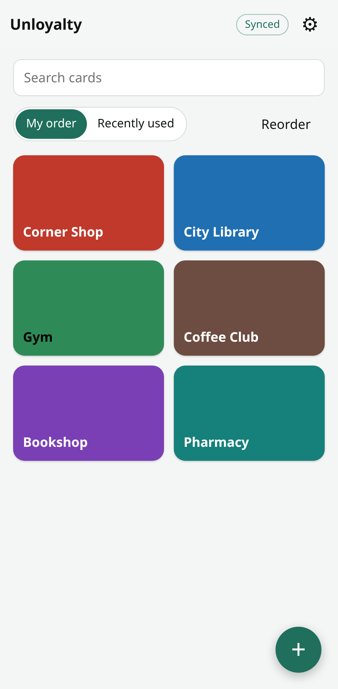
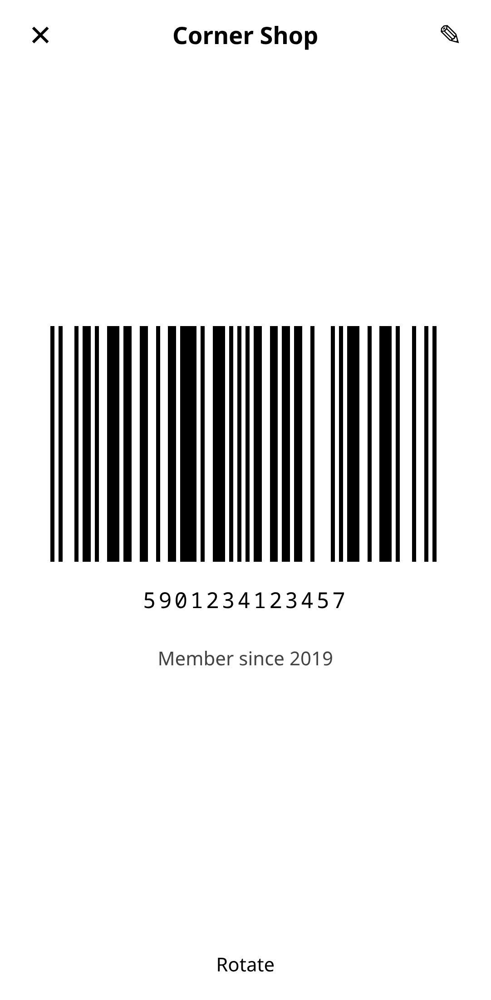
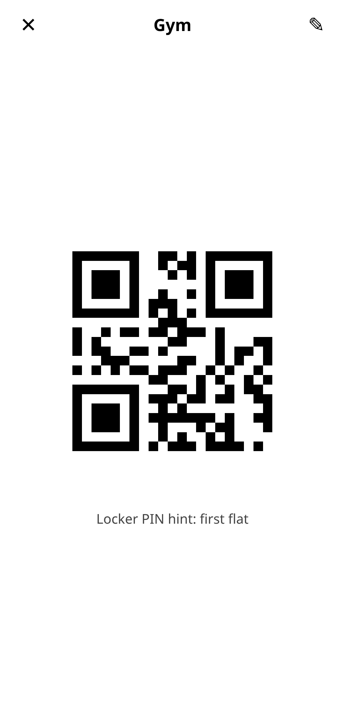
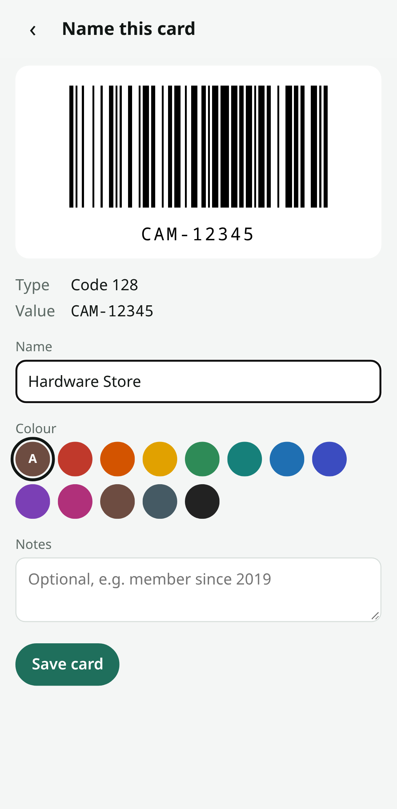
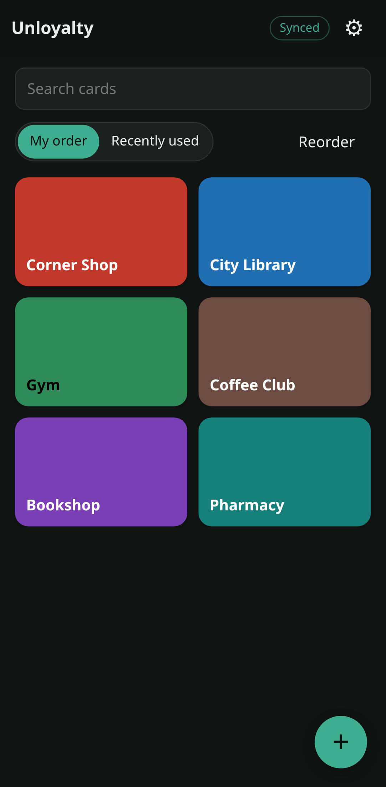
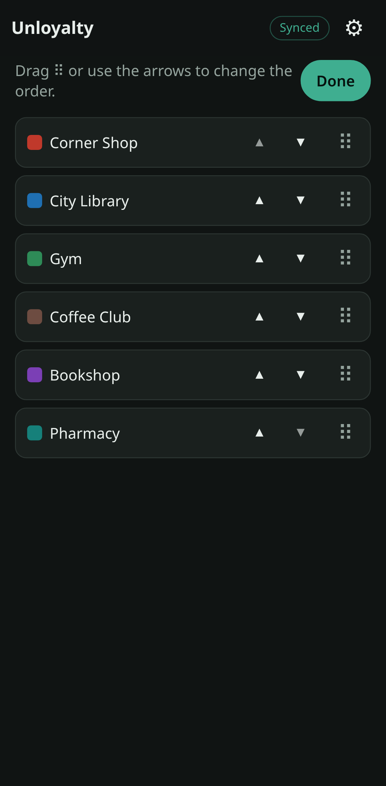
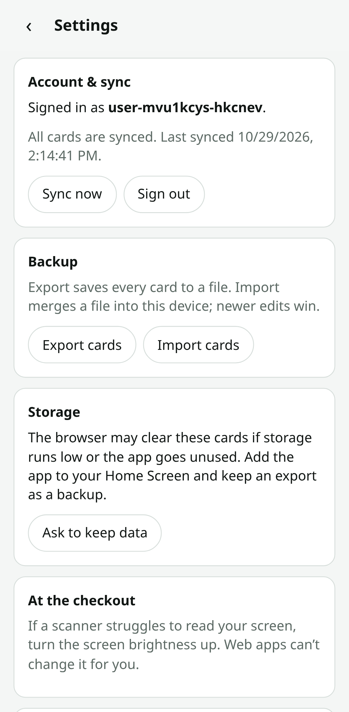

# Unloyalty

[](https://github.com/ehxor/unloyalty/actions/workflows/ci.yml)

A self-hosted, offline-first wallet for loyalty cards, library cards, gym tags and anything else with a barcode. It's a PWA: add it to your phone's Home Screen, scan or type a card in, and show a large, scannable barcode at the checkout. It works with no network at all.

> **Status:** all five milestones done: offline wallet, scanning, the Go server in a 15 MB container, accounts with automatic sync, and polish. What's left is checking on real devices; see the [device checklist](#device-checklist). Design notes and test evidence are in [PLAN.md](PLAN.md).

## Screenshots

<table>
  <tr>
    <td align="center"><br><sub>Wallet</sub></td>
    <td align="center"><br><sub>At the checkout</sub></td>
    <td align="center"><br><sub>2D codes and notes</sub></td>
    <td align="center"><br><sub>After a scan</sub></td>
  </tr>
  <tr>
    <td align="center"><br><sub>Dark mode</sub></td>
    <td align="center"><br><sub>Reorder</sub></td>
    <td align="center"><br><sub>Account &amp; sync</sub></td>
    <td></td>
  </tr>
</table>

<sub>Pixel 7 viewport (412 × 915). Regenerate with `make screenshots`.</sub>

## Features

- **Formats:** Code 128, GS1-128, Code 39 (standard and full ASCII), Code 93, EAN-13, EAN-8, UPC-A, UPC-E, ITF, Codabar, QR, GS1 QR, PDF417, Aztec, Data Matrix, GS1 Data Matrix.
- **Adding cards:** scan live with the camera (torch toggle where supported), scan from a photo or screenshot, or type the number. Check digits are filled in or verified. If camera access is denied, photo and manual entry are right there. A card's barcode can be re-scanned from its edit screen.
- **At the checkout:** pure white screen, quiet zones built in, a rotate toggle for long 1D barcodes, and the screen stays on while the card is open (Wake Lock, where supported).
- **Wallet:** search, colours, your own order (drag the handle or use the arrows), or "Recently used" first. The sort choice is per device.
- **Storage:** everything is kept on the device in IndexedDB. The app asks the browser to keep that storage persistent. In Safari on iOS it shows a one-time hint on how to add the app to the Home Screen.
- **Backup:** export to JSON and import (merged by card ID; newer edits win).
- **Privacy:** no requests to any host other than the app's own origin. No CDNs, analytics or web fonts. The server never logs card data.

## Quick start

The server is published as a multi-arch image (amd64 and arm64, so it runs on a Raspberry Pi):

```sh
docker pull ghcr.io/ehxor/unloyalty:latest
```

| Tag | Contents |
|---|---|
| `latest` | the newest build of `main` |
| `1.2.3`, `1.2` | releases (git tags `v1.2.3`) |
| `sha-abc1234` | one specific commit |

Phones only allow the camera and offline mode over HTTPS, so the server always runs behind something that provides HTTPS. The container serves plain HTTP on port 8080. Data lives in the `/data` volume.

### Tailscale on the Docker host (simplest)

If the machine running Docker is already on your tailnet:

```sh
docker run -d --name unloyalty --restart unless-stopped \
  -p 127.0.0.1:8080:8080 -v unloyalty-data:/data \
  -e TRUST_PROXY_HEADERS=true ghcr.io/ehxor/unloyalty:latest
docker exec -it unloyalty /wallet create-user <you>
tailscale serve --bg 8080
```

Open `https://<machine>.<tailnet>.ts.net` on your phone (with the Tailscale app connected), then Share → **Add to Home Screen**.

### Tailscale sidecar

For a dedicated `unloyalty.<tailnet>.ts.net` name with no Tailscale on the host, use an [auth key](https://login.tailscale.com/admin/settings/keys):

```sh
TS_AUTHKEY=tskey-auth-… docker compose -f docker-compose.tailscale.yml up -d
docker compose -f docker-compose.tailscale.yml exec unloyalty /wallet create-user <you>
```

This needs MagicDNS and HTTPS certificates enabled in the Tailscale admin console.

### Reverse proxy (Traefik, Caddy)

`docker-compose.yml` assumes Traefik is watching Docker, an external `proxy` network, and a certificate resolver named `letsencrypt`:

```sh
UNLOYALTY_HOST=wallet.example.com docker compose up -d
docker compose exec unloyalty /wallet create-user <you>
```

For Caddy: `wallet.example.com { reverse_proxy unloyalty:8080 }`, with `TRUST_PROXY_HEADERS=true`.

## Accounts

- **The first account can always register,** from the app (Settings → Account & sync → Create account) or with `create-user`. After that, registration is closed unless `ALLOW_REGISTRATION=true`.
- **Create the first account with `create-user` before exposing a server publicly.** Otherwise whoever reaches it first gets the first account.
- **Adding accounts later:** `wallet create-user <name>` prompts for the password, or reads `WALLET_PASSWORD`. It works while the server is running.
- **Separate wallets:** each account's cards are private to that account. Sharing cards between accounts isn't supported.

## Sync

- **Signing in:** Settings → Account & sync. Cards already on the device join the account.
- **When it syncs:** when the app opens, when it comes back to the foreground, when the network returns, and about 2 s after any change. iOS gives web apps no background sync, so a change made offline goes up the next time the app is open and online. The chip in the wallet header shows the state: Synced, *N* waiting, Offline, Sync error, or Local only.
- **Conflicts:** per card, the later edit wins. "Last used" (from opening a card at the checkout) never overrides an edit.
- **Signing out removes every card from the device;** they stay on the server. If some changes haven't reached the server yet, the app says how many and offers an export first.
- **Expired sessions:** if a session expires, nothing is removed. Sign in again and syncing resumes. Signing in as a *different* account on a device that still holds someone else's cards asks before removing them.

## Configuration

| Variable | Default | |
|---|---|---|
| `PORT` | `8080` | HTTP port |
| `DATA_DIR` | `/data` | holds `wallet.db` (SQLite) |
| `ALLOW_REGISTRATION` | `false` | let anyone with the URL create an account (the first account is always allowed) |
| `SESSION_TTL` | `90d` | sign-ins expire after this long unused (`90d`, `36h`, `1d12h`) |
| `TRUST_PROXY_HEADERS` | `false` | use `X-Forwarded-For` for login rate limiting and `X-Forwarded-Proto` for HSTS. Only enable when the port isn't reachable except through your proxy. |

## Backup and moving

- **Server backup:** `wallet.db` in the data volume is the whole server state. Copy it while the server is stopped, or take a live copy with `sqlite3 wallet.db ".backup backup.db"`. `GET /api/export` (signed in) returns one account's cards as an export file.
- **Restoring an older backup is safe:** the database carries an ID. Devices that synced with a newer copy notice the change and re-send all their cards.
- **Data is tied to the URL:** the phone stores cards under the exact address the app was installed from. If that address changes, sign in at the new address and the cards sync down (or export, then import).
  - Keep the address the same when switching from `pnpm preview` to the container: run `tailscale serve --bg 8080` on the same machine.
- **Clock skew:** if two devices edit the same card, the edit with the later timestamp wins. A phone whose clock is far off can win or lose unexpectedly. That's acceptable for a personal wallet.

## Development

Requires Node 22.12+, pnpm 10, Go 1.22+ (`GOTOOLCHAIN=auto` fetches the Go version pinned in `server/go.mod`) and Docker for images.

```sh
make install     # pnpm install
make dev         # Vite dev server (no service worker, no API)
make test        # web typecheck + unit tests, go vet + go test
make e2e         # Playwright against the real server binary (CSP, offline, fake camera)
make server      # web build embedded into bin/wallet
make run         # bin/wallet with data in ./data on :8080
make image       # build the container image locally as unloyalty:dev
make budgets     # image size / cold start / idle memory checks
make icons       # regenerate web/public/icons/* from icon.svg
make screenshots # regenerate docs/screenshots/* (seeded account, fake camera)
```

The first `make e2e` needs a browser: `cd web && pnpm exec playwright install chromium`. The camera tests use Chromium's fake camera with a generated barcode video, so no webcam is involved.

**arm64 images:** `docker buildx build --platform linux/arm64 -t unloyalty:arm64 --load .` builds without emulation, because Go cross-compiles. Running that image on an x86 machine needs QEMU (`docker run --privileged --rm tonistiigi/binfmt --install arm64`).

**CI** (`.github/workflows/ci.yml`) runs on every push and pull request:
- **Test job:** web typecheck and unit tests, `go vet` and `go test`, and the Playwright suite against the real server binary.
- **Image job:** builds the image, checks the budgets on amd64, and smoke-tests the arm64 image under QEMU.
- **Publishing:** pushes to `main` and `v*` tags publish to `ghcr.io/ehxor/unloyalty`. Pull requests only build.

**Updating:** `docker pull ghcr.io/ehxor/unloyalty:latest` then recreate the container. The data volume is kept, and the installed app offers "A new version is available — Reload" on its next launch.

## Device checklist

Automated tests run in Chromium with a fake camera. These need a real phone, ideally after each release:

**iPhone, Safari tab:**
- [ ] The "Add to Home Screen" hint shows, and stays gone after you dismiss it.
- [ ] Share → Add to Home Screen gives the Unloyalty icon (not a screenshot) and opens full screen.

**iPhone, installed app:**
- [ ] Live scan: Code 128, EAN-13, UPC-A, QR, PDF417 each go straight to "Name this card" with the right type and number.
- [ ] Torch: the button appears only if the camera offers one, and toggling it works.
- [ ] Deny camera access (Settings → Unloyalty or Safari → Camera): the scan screen explains, and photo and manual entry work.
- [ ] Scan from photo: a screenshot of a barcode.
- [ ] Airplane mode: the app opens and every card shows its barcode.
- [ ] Card view: the screen stays on for over a minute (Wake Lock), and rotate works for a long Code 128.
- [ ] Safe areas: nothing hides under the notch or home indicator, in light and dark mode.
- [ ] Reorder by dragging the handle; the page doesn't scroll while dragging.
- [ ] Edit on the phone, open the app on another device: the change arrives. Edit in airplane mode, reconnect, reopen: it syncs.
- [ ] After deploying a new version: "A new version is available — Reload" appears, but never while a card is open.

**Android Chrome:**
- [ ] Install prompt or menu → Install app. Live scan with torch toggle.

**At a real checkout:**
- [ ] A laser scanner and a camera scanner both read a 1D card from the screen (brightness up).

**Raspberry Pi / arm64 host:**
- [ ] `docker run` the arm64 image; `docker inspect` reports it `healthy`, and the app loads through your HTTPS front.

## Known limits

- Web apps can't change screen brightness. If a scanner struggles, turn the brightness up.
- Some laser scanners can't read phone screens at all. Camera-based scanners are fine.
- iOS may clear storage for web apps that go unused. The Home Screen install and persistent storage make this less likely, and with an account the server holds a copy.

## Licence

MIT
